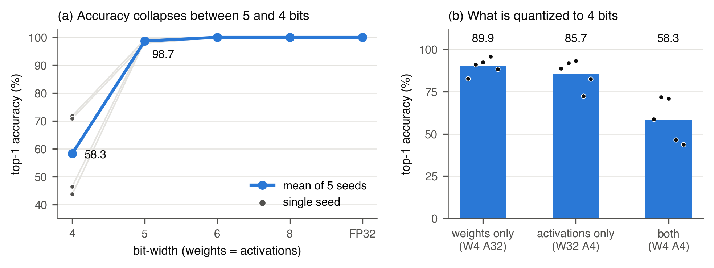
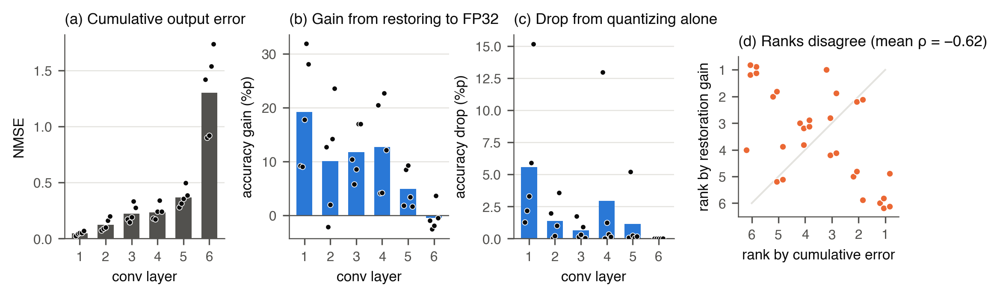
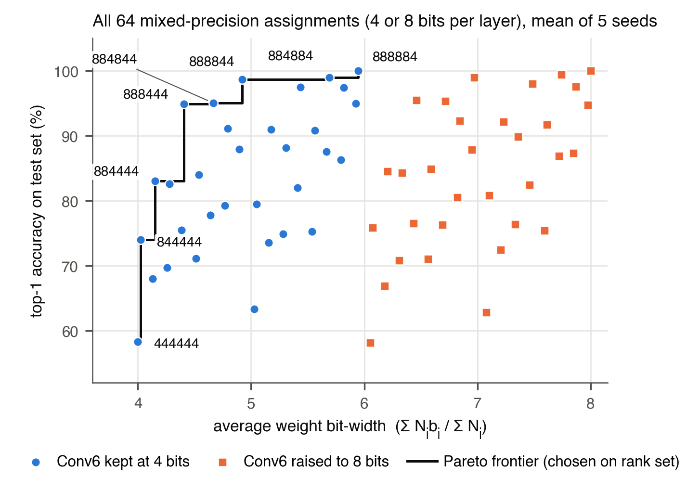
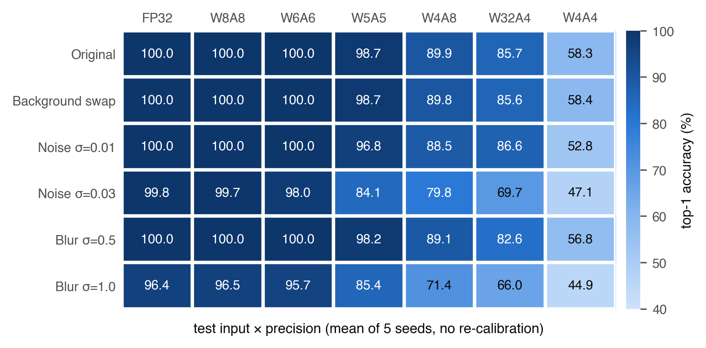
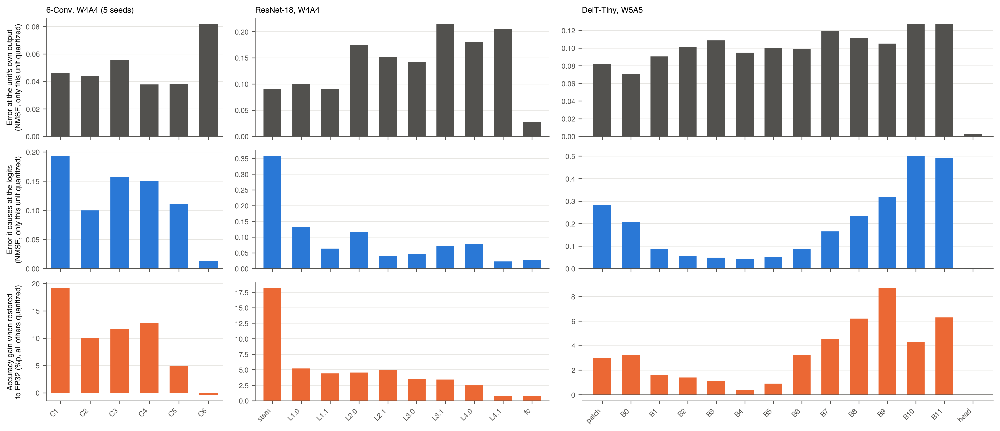
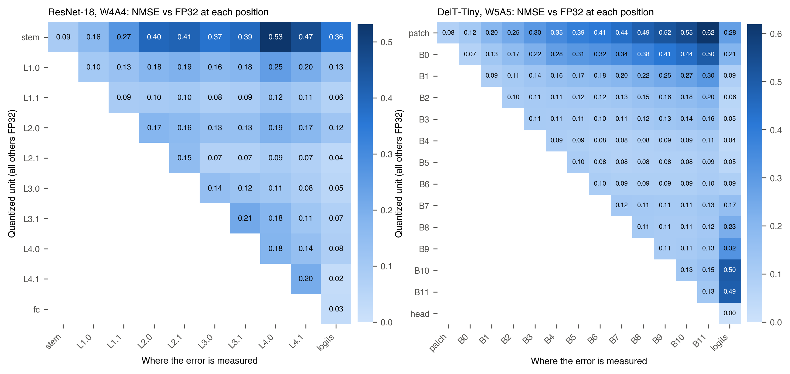
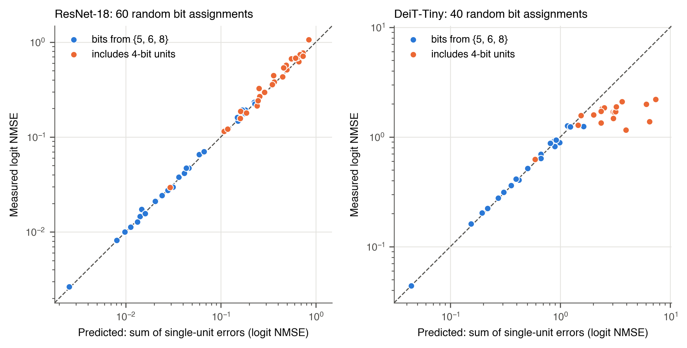
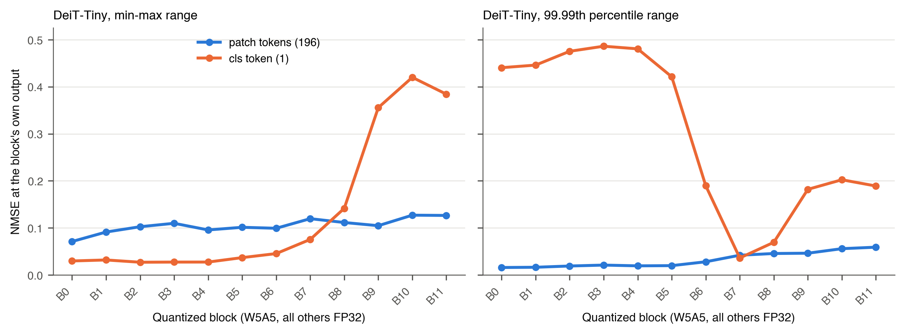

# 효율적인 층별 양자화 설계

층별 오차와 정확도 회복을 분석해 효율적인 양자화 방법을 찾는다.

팀원: 김진서, 이하형, 정채호준

## 주제

6-Conv 예비실험에서는 재학습 없는 양자화(PTQ)를 적용해, 양자화 오차(NMSE)가 큰 층과 FP32로 되돌렸을 때 정확도가 많이 회복되는 층이 같은지 본다.
오차가 큰 층이 꼭 예측을 망치는 층은 아닐 수 있다는 게 가설.

실험은 두 단계로 나눠서 진행한다.

1. 6-Conv CNN + 3D-Shapes : 직접 학습한 작은 모델. Shape / Color / Scale 속성별로 어느 층이 영향을 주는지 확인 (진행 중)
2. ResNet-18, DeiT-Tiny + ImageNet-1K : 두 모델로 실험을 확장한다. 새로 학습할지 사전학습 가중치를 사용할지는 미정 (아직 구현 안 함)

자세한 설정값은 docs/experiment_spec.md 참고. 아직 확정 안 된 값은 잠정이라고 적어놨음.

## 향후 연구 방향

1. ResNet-18과 DeiT-Tiny에서 실험한다. 신규 학습과 사전학습 모델 사용 중 어느 방식을 택할지는 추후 결정한다.
2. 현재 방식 외 다른 양자화 기법을 적용해 비교한다.
3. 비트 수, 대상 층 등 다양한 조건에서 반복 실험한다.
4. 층 위치와 양자화 기법 등의 조건을 종합해 효율적인 양자화 설계 기법을 제안한다.

## 환경

```bash
pip install -r requirements.txt
```

3D-Shapes 데이터(3dshapes.h5, 약 255MB)는 용량 때문에 레포에 안 올렸다. 아래에서 받아서 `data/3dshapes.h5`로 넣으면 됨.

- https://github.com/deepmind/3dshapes-dataset
- https://storage.googleapis.com/3d-shapes/3dshapes.h5

다른 경로에 두고 싶으면 환경변수 `SHAPES3D_H5`에 경로를 넣으면 된다. 실행할 때 파일 해시(SHA-256)를 확인하니까 다른 파일이면 바로 에러 남.

## 실행 방법

```bash
# 테스트
python -m unittest discover -s tests -t .

# FP32 학습만
python -m src.train --seed 0

# 본 실험 (seed 하나에 M4 맥 기준 13분 정도, 끝난 seed는 건너뜀)
python -m src.exp_6conv --seeds 0 1 2 3 4

# 조건 추가 (학습해둔 모델 그대로 쓰고 조건만 더 돌림, seed 하나에 1분 안쪽)
python -m src.exp_extra --conditions W5A5 --seeds 0 1 2 3 4

# 도메인 실험 1차 (배경 변경, noise, blur. 재학습 없음, 30분 정도)
python -m src.exp_domain --seeds 0 1 2 3 4

# 결과 집계 -> results/6conv_fold/summary/
python -m src.analyze --exp results/6conv_fold

# 최종 출력(logit) 오차 (저장된 모델 그대로, seed 하나에 4분 정도) + 집계
python -m src.exp_output_error --seeds 0 1 2 3 4
python -m src.output_summary

# 그림 -> results/6conv_fold/figures/ (집계 CSV만 읽음)
python -m src.figures --exp results/6conv_fold
```

## 폴더

```
src/
  data.py         데이터 로드, 분할 (모든 seed 동일)
  models.py       6-Conv 모델
  train.py        FP32 학습
  quant/
    fold.py       Conv-BN folding
    quantizer.py  fake quantization
    qmodel.py     folding된 모델 + 층별 on/off, calibration
  exp_6conv.py    본 실험
  exp_extra.py    조건 추가 (W5A5 등)
  exp_domain.py   도메인 실험 1차 (배경, noise, blur)
  analyze.py      집계 (순위 상관, mixed precision, Pareto)
  figures.py      그림
tests/            단위 테스트
docs/             실험 규격
results/          summary랑 그림 PNG만 올림 (모델, 이미지별 예측은 제외)
```

## 실험 설정 (6-Conv)

- 모델: Conv 6개 (16/16/32/32/64/64), MaxPool은 Conv2, 4, 6 뒤에만, GAP + Linear head 3개
- 양자화: W는 symmetric per-channel, A는 asymmetric per-tensor, 둘 다 min-max. calibration 2,048장
- BN은 folding한 다음에 양자화. Head랑 입력 이미지는 양자화 안 함
- 층 하나 = Conv의 W + 그 블록 출력 A
- 조건: FP32, W8A8, W6A6, W5A5, W4A8, W4A4, W32A4, W4A32 (W5A5는 나중에 추가)
- seed 5개 (0~4). 분할은 고정이고 seed는 초기값이랑 학습 순서만 바꿈
- 층 순위는 rank 1만 장으로 정하고, 최종 평가는 test 1만 장으로 따로 함

측정하는 것

| 이름 | 설명 |
|---|---|
| 단독 하락 | FP32 모델에서 한 층만 양자화했을 때 정확도 하락 |
| 복원 이득 | 전부 양자화한 모델에서 한 층만 FP32로 되돌렸을 때 정확도 회복 |
| NMSE | 층 출력 오차. 그 층만 양자화했을 때(단독)랑 전부 양자화했을 때(누적) 둘 다 |
| C→W, W→C | 양자화 전후로 정답/오답이 바뀐 이미지 수 |
| 순위 상관 | NMSE 순위랑 복원 순위의 Spearman ρ, top-k 겹침 |
| Mixed precision | 층마다 4/8비트 고르는 64가지 조합 전부 |

## 6-Conv 결과 (5 seed)

집계 파일은 results/6conv_fold/summary/에 있음. 정확도는 test 1만 장, 세 과제 평균 기준.

| 조건 | 정확도(%) | seed 범위 |
|---|---|---|
| FP32 | 100 | - |
| W8A8 | 100 | 틀리게 바뀐 이미지 0개 |
| W6A6 | 100 | 틀리게 바뀐 이미지 0개 |
| W5A5 | 98.68 ± 0.75 | 97.86 ~ 99.64 |
| W4A32 | 89.94 ± 4.87 | 82.65 ~ 95.65 |
| W4A8 | 89.89 ± 5.00 | 82.36 ~ 95.59 |
| W32A4 | 85.69 ± 8.52 | 72.35 ~ 93.13 |
| W4A4 | 58.31 ± 13.16 | 43.71 ~ 71.76 |



W4A4에서 층별로 본 것 (rank 1만 장, seed 평균)

| 층 | 복원 이득(%p) | 단독 하락(%p) | 누적 NMSE | 단독 NMSE |
|---|---|---|---|---|
| Conv1 | 19.21 | 5.56 | 0.046 | 0.046 |
| Conv2 | 10.08 | 1.36 | 0.123 | 0.044 |
| Conv3 | 11.73 | 0.63 | 0.224 | 0.056 |
| Conv4 | 12.74 | 2.94 | 0.235 | 0.038 |
| Conv5 | 4.91 | 1.15 | 0.365 | 0.038 |
| Conv6 | -0.45 | 0.00 | 1.302 | 0.082 |



검은 점은 seed 하나씩. (d)는 누적 NMSE 순위랑 복원 이득 순위를 seed별로 찍은 것이고, 대각선 위에 있어야 두 순위가 같은 것.

- 8비트, 6비트에서는 정확도가 안 변함. 5비트부터 조금씩 틀리기 시작하고(평균 -1.3%p) 4비트에서 크게 무너짐
  - 5비트에서 제일 많이 떨어지는 과제는 Color (96.95%), Shape은 거의 그대로 (99.91%)
- NMSE 순위랑 복원 이득 순위가 안 맞음. 누적 NMSE 기준 ρ 평균 -0.62, 1등 층은 5개 seed 전부 다름
  - 층이 6개뿐이라 |ρ| 0.886 이상이어야 유의한데, 넘은 건 seed 1개
  - 누적 NMSE는 뒤 층일수록 앞 층 오차가 쌓여서 커지는 것도 감안해야 함
- Conv6은 단독 NMSE가 5개 중 4개 seed에서 제일 큰데, 혼자 양자화했을 때 정확도 하락은 전부 0
- Conv1 ~ 5만 8비트로 두고 Conv6만 4비트로 해도 (평균 5.95비트) 5개 seed 전부 100%
- seed마다 편차가 커서 층 사이의 작은 차이는 해석하기 어려움
- BN folding은 결과에 거의 영향이 없었음. 11/9 예비 실험(folding 없음)이랑 수치가 거의 같음

Mixed precision은 두 가지로 나눠서 봄 (서로 다른 실험)

1. 상위 k개 층만 8비트 (어떤 지표가 중요한 층을 잘 찾는지). test 정확도(%)

| 층 고르는 기준 | k=1 | k=2 | k=3 |
|---|---|---|---|
| 복원 이득 순위 | 76.2 | 90.7 | 95.1 |
| 누적 NMSE 순위 | 58.1 | 62.8 | 77.6 |
| 앞층부터 | 74.0 | 83.0 | 94.9 |
| 무작위 평균 | 67.4 | 75.5 | 84.3 |

2. 같은 저장 비용에서 비교 (B = 층별 가중치 수 x 비트의 합). 64조합의 Pareto frontier, rank로 고르고 test로 평가

| 조합 (Conv1~6 비트) | 평균 비트 | test 정확도(%) |
|---|---|---|
| 444444 | 4.00 | 58.31 ± 13.16 |
| 844444 | 4.02 | 73.98 ± 11.06 |
| 884444 | 4.15 | 82.99 ± 8.30 |
| 888444 | 4.41 | 94.89 ± 3.30 |
| 884844 | 4.67 | 95.03 ± 3.60 |
| 888844 | 4.92 | 98.67 ± 2.70 |
| 884884 | 5.69 | 98.94 ± 1.27 |
| 888884 | 5.95 | 100.00 |



- frontier가 거의 "앞 층부터 8비트"임. 앞 층은 가중치 수가 적어서 싸고, 복원 이득도 커서 그런 것
- 그래서 비트 예산을 평균 5, 6으로 맞추면 어떤 순위를 쓰든 같은 조합(888844, 888884)이 나옴. 점수를 비용으로 나눠서 골라도 마찬가지
- 예산 7에서는 NMSE 순위만 Conv6을 먼저 골라서 100%가 안 됨 (98.9%)

## 도메인 실험 1차 (5 seed)

학습해둔 모델은 그대로 두고 평가 이미지만 바꿈. calibration도 원본 이미지로 한 것 그대로. test 1만 장, 세 과제 평균(%).

| 입력 | FP32 | W8A8 | W6A6 | W5A5 | W4A8 | W32A4 | W4A4 |
|---|---|---|---|---|---|---|---|
| 원본 | 100 | 100 | 100 | 98.68 | 89.89 | 85.69 | 58.31 |
| 배경(벽, 바닥 색) 변경 | 100 | 100 | 100 | 98.71 | 89.81 | 85.59 | 58.35 |
| Noise σ=0.01 | 100 | 100 | 100 | 96.77 | 88.55 | 86.62 | 52.76 |
| Noise σ=0.03 | 99.78 | 99.69 | 98.01 | 84.11 | 79.80 | 69.69 | 47.06 |
| Blur σ=0.5 | 100 | 100 | 100 | 98.18 | 89.14 | 82.61 | 56.76 |
| Blur σ=1.0 | 96.43 | 96.47 | 95.72 | 85.42 | 71.43 | 65.99 | 44.93 |



- 배경만 바꾼 건 차이 없음. 근데 지금 모델은 벽, 바닥 색을 학습 때 전부 봤기 때문에 이건 분포 변화 실험은 아님 (그건 색 조합을 빼고 다시 학습해야 해서 2차로 미룸)
- Noise σ=0.03은 FP32에서는 거의 안 떨어지는데(99.78) 비트가 낮을수록 많이 떨어짐. W6A6 98.01, W5A5 84.11
  - seed 편차도 커짐. W5A5 표준편차가 원본 0.75에서 15.52로
  - Conv1만 W4A4로 했을 때 하락이 원본 5.6%p에서 26.9%p로 커짐
- Blur σ=1.0은 FP32부터 떨어지고(96.43, 주로 Scale) 양자화하면 더 떨어짐
- 누적 NMSE 순위와 복원 이득 순위가 안 맞는 건 모든 입력에서 똑같이 나옴 (ρ 평균 -0.52 ~ -0.62, 1등 층 겹침 0)
- 복원 이득 순위 자체는 입력이 바뀌어도 대체로 유지됨 (원본 순위와의 ρ 평균 0.77 ~ 0.99). Conv1이 계속 1등인 경우가 많음

## 최종 출력 오차 (6-Conv, 5 seed)

층별로는 출력 오차(NMSE)를 쟀는데 최종 출력은 정답을 맞혔는지만 봤어서, 최종 출력(과제별 Head의 logit)에서도 FP32랑 얼마나 다른지 쟀다. 저장된 모델과 보정 범위를 그대로 썼고, W4A4 예측이 본 실험 기록이랑 똑같은지 seed마다 확인함.

- 최종 출력 NMSE = ‖z − ẑ‖² / ‖z‖² (z: FP32 logit, ẑ: 양자화 모델 logit). 층별 NMSE랑 같은 식
- KL = KL(softmax(z) ‖ softmax(ẑ)). 확률이 얼마나 바뀌었는지. 보조 지표로 넣은 거라 잠정
- Head는 양자화하지 않으니까 최종 출력 오차는 전부 앞 층에서 넘어온 것
- 최종 출력 오차 감소량 = (전 층 양자화 상태의 최종 출력 NMSE) − (층 i만 FP32로 되돌렸을 때의 최종 출력 NMSE)

조건별 (test 1만 장, 세 과제 평균)

| 조건 | 정확도(%) | 최종 출력 NMSE | KL |
|---|---|---|---|
| W8A8 | 100 | 0.0019 ± 0.0010 | 0.0001 |
| W6A6 | 100 | 0.040 ± 0.019 | 0.002 |
| W5A5 | 98.68 | 0.142 ± 0.034 | 0.048 |
| W4A8 | 89.89 | 0.287 ± 0.115 | 0.322 |
| W4A32 | 89.94 | 0.282 ± 0.116 | 0.319 |
| W32A4 | 85.69 | 0.475 ± 0.104 | 0.463 |
| W4A4 | 58.31 | 1.145 ± 0.447 | 2.393 |

W4A4 층별 (rank 1만 장, seed 평균). 전 층 W4A4일 때 최종 출력 NMSE는 1.147

| 층 | 층 누적 NMSE | 복원 이득(%p) | 복원 시 최종 출력 NMSE | 최종 출력 오차 감소량 | 그 층만 양자화했을 때 최종 출력 NMSE |
|---|---|---|---|---|---|
| Conv1 | 0.046 | 19.20 | 0.592 | 0.556 | 0.193 |
| Conv2 | 0.123 | 10.07 | 0.888 | 0.259 | 0.100 |
| Conv3 | 0.224 | 11.73 | 0.682 | 0.466 | 0.157 |
| Conv4 | 0.235 | 12.73 | 0.731 | 0.416 | 0.150 |
| Conv5 | 0.365 | 4.91 | 1.076 | 0.071 | 0.111 |
| Conv6 | 1.302 | -0.45 | 1.120 | 0.028 | 0.013 |

순위 상관 (W4A4, seed 평균 ρ, 괄호는 |ρ| ≥ 0.886인 seed 수)

| 비교 | ρ |
|---|---|
| 층 누적 NMSE vs 최종 출력 오차 감소량 | -0.49 (0/5) |
| 최종 출력 오차 감소량 vs 복원 이득 | 0.89 (2/5) |
| KL 감소량 vs 복원 이득 | 0.94 (3/5) |
| 그 층만 양자화했을 때 최종 출력 KL vs 단독 하락 | 0.99 (5/5) |

- 층 출력 오차가 제일 큰 Conv6은 되돌려도 최종 출력 오차가 거의 안 줄어듦 (1.147 → 1.120). 제일 많이 줄어드는 건 Conv1 (→ 0.592)
- 최종 출력 오차 감소량 순위는 복원 이득(정확도) 순위랑 잘 맞음. 반대로 층 누적 NMSE 순위랑은 안 맞음
- 그래서 "층 출력 오차가 큰 층 ≠ 최종 출력을 많이 망가뜨리는 층"이 정확도뿐 아니라 최종 출력 오차로 봐도 같게 나옴
- W8A8, W6A6은 정확도가 100%라 정확도로는 층 순위를 못 매기는데, 최종 출력 오차로는 매길 수 있음. W6A6에서도 감소량은 Conv1·3·4가 크고 Conv6이 제일 작음(0.0125, 0.0130, 0.0106 vs 0.0018). 다만 값이 작아서 seed 편차가 크다(층 누적 NMSE와의 ρ 0.02 ± 0.72)
- 전체 표: `results/6conv_fold/summary/output_conditions.csv`, `output_layers.csv`, `output_rank_corr.csv`

## ImageNet 사전학습 모델 (ResNet-18, DeiT-Tiny)

6-Conv에서 본 결과가 실제로 많이 쓰는 모델에서도 나오는지 확인하려고 추가한 실험이다. 재학습 없이 사전학습 가중치를 그대로 쓴다. 아직 1회 측정이고 아래 "잠정" 항목은 팀에서 확정하기 전이다.

### 데이터 받기

Hugging Face [timm/imagenet-1k-wds](https://huggingface.co/datasets/timm/imagenet-1k-wds)를 쓴다. 페이지에서 약관에 동의하고 Read 토큰으로 로그인해야 받을 수 있다.

```bash
python -c "from huggingface_hub import login; login()"

# val 묶음 받기 (약 7GB) -> data/imagenet/raw
python -c "from huggingface_hub import snapshot_download; snapshot_download('timm/imagenet-1k-wds', repo_type='dataset', allow_patterns=['imagenet1k-validation-*.tar'], local_dir='data/imagenet/raw')"

# 보정용 train 2,048장 받기, rank/test 목록 만들기, 전처리 배열 만들기
python -m src.imagenet_data --calib --val --cache
```

`data/splits/imagenet_*.json`에 우리가 쓴 분할 목록이 들어 있어서, `--calib --val` 없이 `--cache`만 돌려도 같은 이미지를 쓸 수 있다(보정용 JPEG는 따로 받아야 함).

### 실행

```bash
# FP32 기준 정확도 + 전 단위 동일 비트 조건 (12분 정도)
python -m src.exp_imagenet

# 단위별 복원·교체 실험 (조건 하나에 5~6분)
python -m src.exp_imagenet_units --models resnet18 --conditions W4A4 W5A5
python -m src.exp_imagenet_units --models deit_tiny --conditions W4A4 W5A5 W6A6

# 최종 출력(logit) 오차. 조건별 + 단위별 실험을 돌린 조건 전부 (두 모델 50분 정도) + 집계
python -m src.exp_imagenet_output --models resnet18 deit_tiny
python -m src.output_summary

# 정책별 상위 k 단위 8비트 승격 (최종 출력 기준 out, out_kl은 output_units.csv가 있어야 함)
python -m src.exp_imagenet_mixed --models resnet18 --bases W4A4 W5A5
python -m src.exp_imagenet_mixed --models deit_tiny --bases W5A5 W6A6

# 오차 전달 분석 (rank 앞쪽 2,000장. ResNet-18 20분, DeiT-Tiny 25분 정도) + 집계 + 그림
python -m src.exp_imagenet_propagation --models resnet18 deit_tiny
python -m src.propagation_summary
python -m src.figures_propagation
```

### 설정

| 항목 | 내용 |
|---|---|
| 모델 | ResNet-18 (torchvision, IMAGENET1K_V1), DeiT-Tiny (timm `deit_tiny_patch16_224`) |
| 데이터 | 보정 train 2,048장, rank val 5,000장, test val 10,000장 (서로 안 겹침) |
| 단위 | ResNet-18: Stem, BasicBlock 8개, FC (10개) / DeiT-Tiny: Patch Embed, Block 12개, Head (14개) |
| 양자화 | 단위 안의 Conv/Linear 가중치 + 단위 출력 활성값. 규칙은 6-Conv와 같음 (W 대칭 per-channel, A 비대칭 per-tensor min-max) |
| ResNet BN | Conv에 합친 뒤 보정·양자화 |

잠정으로 둔 것

- 블록 안쪽의 중간 활성값은 양자화하지 않고 블록 출력만 양자화한다.
- FC/Head는 가중치만 양자화하고 logit은 양자화하지 않는다.
- Stem 출력은 MaxPool 뒤, Patch Embed 출력은 projection 직후로 본다.
- rank/test는 클래스 균형으로 뽑았다 (클래스당 5장, 10장).
- 전처리는 모델별 공식 설정을 따랐다 (ResNet-18: 256 bilinear, DeiT-Tiny: 248 bicubic, 둘 다 가운데 224).

### 결과 (1회 측정)

조건별 top-1 정확도 (test 10,000장, %)

| 조건 | ResNet-18 | DeiT-Tiny |
|---|---|---|
| FP32 | 69.19 | 71.90 |
| W8A8 | 68.94 | 71.47 |
| W6A6 | 67.25 | 62.33 |
| W5A5 | 58.52 | 6.75 |
| W4A4 | 17.13 | 0.13 |
| W4A8 | 44.28 | 64.07 |
| W32A4 | 36.58 | 0.11 |
| W4A32 | 44.30 | 64.36 |

FP32 정확도는 알려진 수치(ResNet-18 69.8%, DeiT-Tiny 72.2%)와 거의 같다. DeiT-Tiny는 활성값을 줄였을 때 훨씬 빨리 무너진다.

ResNet-18 W4A4 단위별 결과 (rank 5,000장, 전체 양자화 16.92%)

| 단위 | 복원 이득 (%p) | 단독 하락 (%p) | 누적 NMSE | 단독 NMSE |
|---|---|---|---|---|
| stem | 18.82 | 18.08 | 0.091 | 0.091 |
| layer1.0 | 5.62 | 5.18 | 0.250 | 0.100 |
| layer1.1 | 4.38 | 1.90 | 0.439 | 0.091 |
| layer2.0 | 5.04 | 4.34 | 0.710 | 0.174 |
| layer2.1 | 4.84 | 1.06 | 0.849 | 0.150 |
| layer3.0 | 3.14 | 1.44 | 0.876 | 0.141 |
| layer3.1 | 3.18 | 2.44 | 1.097 | 0.214 |
| layer4.0 | 2.18 | 1.06 | 1.370 | 0.179 |
| layer4.1 | 0.54 | 0.20 | 1.498 | 0.205 |
| fc | 0.64 | 0.62 | 1.171 | 0.027 |

오차 순위와 복원 순위 비교 (rank 5,000장)

| 모델 | 조건 | 전체 양자화 (%) | ρ (누적 NMSE vs 복원 이득) | 복원 이득 상위 3 | 누적 NMSE 상위 3 |
|---|---|---|---|---|---|
| ResNet-18 | W4A4 | 16.92 | -0.94 | stem, layer1.0, layer2.0 | layer4.1, layer4.0, fc |
| ResNet-18 | W5A5 | 60.02 | -0.63 | stem, layer1.0, layer2.0 | layer4.0, layer4.1, layer3.1 |
| DeiT-Tiny | W4A4 | 0.06 | 0.13 | (전부 0.2%p 이하) | head, block11, block10 |
| DeiT-Tiny | W5A5 | 6.74 | 0.26 | block9, block8, block11 | head, block11, block10 |
| DeiT-Tiny | W6A6 | 63.92 | 0.12 | block9, patch_embed, block11 | head, block11, block10 |

- ResNet-18은 6-Conv와 같은 모양이다. 오차는 뒤쪽 단위가 큰데 복원 이득은 Stem이 가장 크다.
- DeiT-Tiny는 뚜렷한 관계가 없다. W4A4에서는 단위 하나를 복원해도 회복이 안 되고, W6A6의 이득은 1%p 안팎이라 잡음과 구분이 안 된다.
- 누적 NMSE는 뒤로 갈수록 쌓이는 값이라 깊이와 섞여 있다. 단독 NMSE로 보면 ResNet-18 W4A4의 ρ는 -0.26이다.
- 전체 표는 `results/imagenet/summary/units.csv`, `rank_corr.csv`에 있다.

아직 안 한 것: 정책 6개(Early-High, Late-High, NMSE, 단독 민감도, 복원 이득, Random)로 상위 1·2·3 단위를 8비트로 올리는 비교, test 평가.

### 최종 출력 오차 (1회 측정)

6-Conv의 최종 출력 오차와 같은 지표(최종 logit의 NMSE, KL). 분류기 logit은 양자화하지 않으므로 오차는 분류기 가중치 양자화와 앞 단위에서 넘어온 것. 단위별 실험의 예측과 같은지 상태마다 확인함.

조건별 (test 10,000장)

| 조건 | ResNet-18 정확도 | ResNet-18 NMSE | ResNet-18 KL | DeiT-Tiny 정확도 | DeiT-Tiny NMSE | DeiT-Tiny KL |
|---|---|---|---|---|---|---|
| W8A8 | 68.94 | 0.003 | 0.005 | 71.47 | 0.044 | 0.021 |
| W6A6 | 67.25 | 0.055 | 0.110 | 62.33 | 0.729 | 0.540 |
| W5A5 | 58.52 | 0.260 | 0.616 | 6.75 | 2.131 | 4.010 |
| W4A4 | 17.13 | 1.170 | 4.481 | 0.13 | 2.224 | 5.216 |
| W4A8 | 44.28 | 0.511 | 1.519 | 64.07 | 0.410 | 0.326 |
| W4A32 | 44.30 | 0.511 | 1.515 | 64.36 | 0.368 | 0.297 |
| W32A4 | 36.58 | 0.661 | 2.223 | 0.11 | 2.223 | 5.213 |

- DeiT-Tiny는 활성값 4·5비트에서 최종 출력 NMSE가 2.1~2.2로 거의 같아짐(정확도도 거의 0). NMSE가 포화돼서 이 구간 비교는 KL이 나음

단위별 (rank 5,000장). 최종 출력 오차 감소량 = 전 단위 양자화 상태의 최종 출력 NMSE − 단위 i만 FP32로 되돌렸을 때의 값

| 모델 | 조건 | 전 단위 양자화 최종 NMSE | 감소량 상위 3 | 복원 이득 상위 3 |
|---|---|---|---|---|
| ResNet-18 | W4A4 | 1.169 | stem 0.41, layer2.0 0.21, layer4.0 0.20 | stem, layer1.0, layer2.0 |
| ResNet-18 | W5A5 | 0.259 | stem 0.13, layer1.0 0.05, layer4.0 0.02 | stem, layer1.0, layer2.0 |
| DeiT-Tiny | W4A4 | 2.226 | block6 0.60, block7 0.52, block5 0.38 | (전부 0.2%p 이하) |
| DeiT-Tiny | W5A5 | 2.140 | block9 0.22, block8 0.17, patch_embed 0.10 | block9, block8, block11 |
| DeiT-Tiny | W6A6 | 0.725 | block10 0.13, block11 0.11, block9 0.11 | block9, patch_embed, block11 |

순위 상관 (Spearman ρ)

| 모델 | 조건 | 단위 누적 NMSE vs 최종 출력 오차 감소량 | 최종 출력 오차 감소량 vs 복원 이득 | KL 감소량 vs 복원 이득 | 그 단위만 양자화했을 때 최종 출력 KL vs 단독 하락 |
|---|---|---|---|---|---|
| ResNet-18 | W4A4 | -0.52 | 0.55 | 0.93 | 0.97 |
| ResNet-18 | W5A5 | -0.56 | 0.67 | 0.83 | 0.59 |
| DeiT-Tiny | W4A4 | -0.26 | -0.08 | 0.15 | 0.96 |
| DeiT-Tiny | W5A5 | 0.05 | 0.90 | 0.99 | 0.92 |
| DeiT-Tiny | W6A6 | 0.30 | 0.81 | 0.85 | 0.88 |

- ResNet-18도 6-Conv처럼 단위 출력 오차가 큰 뒤쪽 단위보다 stem을 되돌릴 때 최종 출력 오차가 가장 많이 줄어듦
- 최종 출력 KL 감소량은 복원 이득(정확도)과 순위가 잘 맞음 (DeiT-Tiny W4A4 제외. 이 조건은 정확도가 0에 가까워서 복원 이득 자체가 잡음)
- DeiT-Tiny W4A4는 정확도로는 단위 차이가 안 보였는데, 최종 출력 오차로 보면 block5~7을 되돌릴 때 많이 줄어듦. 정확도가 무너진 조건에서도 단위를 비교할 수 있음
- DeiT-Tiny는 단위 출력 누적 NMSE와 최종 출력 오차 감소량 순위가 거의 무관함(ρ -0.26 ~ 0.30)
- 최종 출력 오차는 정답 라벨 없이 잴 수 있어서, 보정 데이터만으로 중요한 단위를 고르는 기준으로 쓸 수 있음. Mixed 정책 비교 결과는 아래
- 전체 표: `results/imagenet/summary/output_conditions.csv`, `output_units.csv`, `output_rank_corr.csv`

## 최종 출력 오차를 Mixed 정책 기준으로 쓰기

복원했을 때 최종 출력 오차가 많이 줄어드는 층(단위)부터 8비트로 올리는 정책 2개를 추가함. 기준 순위는 다른 정책처럼 rank 묶음에서만 정하고 test로 평가.

- 최종 출력 NMSE 감소 순위 (ImageNet 정책 이름 `out`)
- 최종 출력 KL 감소 순위 (`out_kl`)
- 복원 이득·단독 하락은 정답 라벨이 있어야 계산되는데, 이 두 개는 FP32 출력이랑만 비교해서 라벨이 필요 없음. 측정에 드는 순전파 횟수는 복원 이득과 같음

6-Conv, 상위 k개 층만 8비트 (test 정답률 %, 세 과제 평균, 5 seed). 64조합은 이미 다 평가돼 있어서 새로 돌리지 않고 찾아서 씀

| 층 고르는 기준 | k=1 | k=2 | k=3 |
|---|---|---|---|
| 최종 출력 KL 감소 | 76.17 | 91.40 | 96.45 |
| 최종 출력 NMSE 감소 | 76.16 | 89.14 | 94.94 |
| 복원 이득 | 76.17 | 90.66 | 95.10 |
| 앞층부터 | 73.98 | 82.99 | 94.89 |
| 누적 NMSE | 58.14 | 62.80 | 77.58 |
| 무작위 조합 평균 | 67.36 | 75.51 | 84.33 |
| rank 전수 조사 최적 | 78.44 | 93.08 | 97.99 |

같은 예산(평균 5·6·7비트)으로 고를 때는 다른 순위 기준들과 거의 같은 조합이 나와서 차이 없음 (98.67, 100.00, 99.97). 표는 `results/6conv_fold/summary/output_mixed.csv`

ImageNet, 상위 3개 단위만 8비트 (test 정답률 %, 괄호는 평균 가중치 비트)

| 모델 · 기준 비트 | 최종 출력 KL 감소 | 최종 출력 NMSE 감소 | 복원 이득 | 단독 하락 | 앞쪽부터 | 누적 NMSE |
|---|---|---|---|---|---|---|
| ResNet-18 W4A4 (17.13) | 54.80 (4.11) | 46.96 (5.34) | 54.80 (4.11) | 54.80 (4.11) | 50.05 (4.05) | 19.26 (7.05) |
| ResNet-18 W5A5 (58.52) | 67.73 (5.08) | 67.02 (5.96) | 67.73 (5.08) | 67.23 (5.32) | 67.37 (5.04) | 59.86 (7.46) |
| DeiT-Tiny W5A5 (6.75) | 32.93 (5.70) | 33.44 (5.55) | 32.93 (5.70) | 23.96 (5.55) | 18.85 (5.55) | 24.57 (5.57) |
| DeiT-Tiny W6A6 (62.33) | 65.51 (6.47) | 65.51 (6.47) | 66.10 (6.37) | 66.50 (6.37) | 65.66 (6.37) | 64.66 (6.38) |

- KL 감소 기준은 ResNet-18 두 조건, DeiT-Tiny W5A5에서 복원 이득 기준이랑 같은 단위를 고름 (ResNet stem·layer1.0·layer2.0, DeiT block8·9·11). 라벨 없이 같은 결과가 나온다는 뜻
- NMSE 감소 기준은 ResNet에서 layer4.0을 골라서(가중치가 많은 단위) 비트는 더 쓰고 정확도는 낮음. DeiT-Tiny W5A5에서는 33.44로 제일 높음
- DeiT-Tiny W6A6은 모든 정책이 64~67% 사이라 구분이 어려움. 여기서는 최종 출력 기준이 단독 하락·복원 이득보다 1%p 정도 낮음
- 상위 k개 비교라 정책마다 비트 비용이 다름. 같은 저장 비용 조건 비교는 아직 안 함
- ImageNet은 1회 측정
- 표는 `results/imagenet/summary/mixed_topk.csv` (정책 `out`, `out_kl`)

## 오차 전달 분석 (ResNet-18, DeiT-Tiny)

누적 NMSE 순위랑 복원 이득 순위가 왜 다른지 직접 재 본 실험. 단위 하나만 양자화하고, 그 오차가 뒤 단위들과 최종 출력(logit)에서 얼마가 되는지 잼.
rank 앞쪽 2,000장만 썼고(발열 때문에 줄임) 보정 세트는 하나(seed 0)라서 전부 잠정임. 정확도 차이 1~2%p는 해석 안 함.
"층 오차 크기와 민감도는 다르다", "층별 영향은 더해진다"는 건 이미 알려진 얘기임(HAWQ, ZeroQ 계열). 여기서는 그걸 Hessian 추정 없이 직접 측정해서 CNN이랑 ViT에서 어떻게 다른지 본 것.

### 오차 크기는 비슷한데 출력까지 가는 비율이 다름



- 단위 하나만 양자화했을 때 그 단위 출력의 오차(위 줄)는 단위마다 비슷함. ResNet-18 W4A4 0.09~0.21, DeiT-Tiny W5A5 0.07~0.13
- 그 오차가 최종 출력에서 얼마가 되는지(가운데 줄)는 10배 넘게 다르고, 복원 이득(아래 줄)은 이쪽을 따라감
- 증폭률 = 최종 출력 오차 / 단위 출력 오차 (상대 오차끼리의 비율이라 절대 배율은 아님)

| 모델 | 증폭률 |
|---|---|
| 6-Conv W4A4 (5 seed) | Conv1~5 2.2~4.2배, Conv6 0.16배 |
| ResNet-18 W4A4 | stem 3.9배, layer1.0 1.3배, 그 뒤 0.3~0.7배, layer4.1 0.11배 |
| DeiT-Tiny W5A5 | patch_embed 3.4배, block0 2.9배, block2~5 0.4~0.6배, block9~11 3.0~3.9배 (U자) |

복원 이득과의 순위 상관 ρ (rank 앞쪽 2,000장)

| 조건 | 누적 NMSE | 단위 출력 오차 | 그 단위가 만든 최종 출력 오차 |
|---|---|---|---|
| ResNet-18 W4A4 | -0.92 | -0.28 | 0.70 |
| ResNet-18 W5A5 | -0.62 | -0.22 | 0.92 |
| DeiT-Tiny W5A5 | 0.31 | 0.60 | 0.88 |



- ResNet-18: stem에서 생긴 오차 0.09가 뒤로 가면서 layer4.0에서 0.53까지 커짐. 반대로 layer4.1 자기 오차 0.20은 평균 풀링이랑 fc를 지나면 0.02가 됨
- 전부 양자화했을 때 layer4.1 위치의 누적 오차 1.50 중 layer4.1에서 새로 생긴 몫은 13%. 나머지는 앞에서 넘어온 것. DeiT-Tiny block11은 5%
- 누적 NMSE가 뒤 단위일수록 큰 건 넘어온 오차가 쌓여서이고, 그 단위를 복원해도 넘어온 오차는 안 없어짐

### 단위별 오차를 더하면 조합의 오차가 예측되는가

단위마다 비트를 다르게 준 무작위 조합(ResNet-18 60개, DeiT-Tiny 40개)을 실제로 평가하고, 단일 측정값(단위 하나만 그 비트로 양자화했을 때의 최종 출력 NMSE)을 더한 예측이랑 비교함.



| 모델 | 비트 묶음 | 실제 / 예측 (중앙값, 범위) | 예측-실제 순위 상관 | 예측 오차-정확도 순위 상관 |
|---|---|---|---|---|
| ResNet-18 | {6,8} | 1.02 (0.95~1.17) | 0.99 | -0.58 |
| ResNet-18 | {5,6,8} | 1.01 (0.95~1.14) | 0.98 | -0.97 |
| ResNet-18 | {4,5,6,8} | 1.04 (0.89~1.29) | 0.98 | -0.98 |
| ResNet-18 | {4,8} | 1.08 (0.95~1.26) | 0.98 | -0.96 |
| DeiT-Tiny | {6,8} | 1.03 (0.96~1.05) | 0.99 | -0.79 |
| DeiT-Tiny | {5,6,8} | 1.01 (0.76~1.08) | 0.88 | -0.69 |
| DeiT-Tiny | {4,5,6,8} | 0.58 (0.49~1.06) | 0.60 | -0.70 |
| DeiT-Tiny | {4,8} | 0.46 (0.21~1.02) | 0.72 | -0.95 |

- ResNet-18은 4비트 단위가 섞여도 합으로 예측이 됨. 단일 측정 40번(단위 10개 x 비트 4종)으로 조합의 오차 순위를 거의 맞춤
- DeiT-Tiny는 예측값이 1 근처까지는 맞고, 그보다 크면 실제 오차가 2 근처에서 더 안 커져서(출력이 이미 망가진 상태) 예측이 과하게 나옴. 4비트 단위가 들어가면 대부분 이 구간
- {6,8}에서 정확도 상관이 낮은 건 정확도가 거의 안 변하는 구간이라 그럼
- 4·8비트 조합 전수(DeiT-Tiny 16,384개)를 다 돌리는 대신, 맞는 구간에서는 이 예측으로 후보를 먼저 추릴 수 있음. 아직 Pareto 선택에 써 보지는 않음

### W와 A 중 어느 쪽인가

- ResNet-18 stem(4비트): W만 양자화하면 최종 출력 오차 0.14(정확도 -6.0%p), A만 하면 0.32(-15.1%p). 다른 단위는 W, A가 비슷하거나 W가 더 큼
- DeiT-Tiny(5비트): 모든 블록에서 오차의 92~99%가 A에서 옴. W만 5비트로 하면 최종 출력 오차 0.003~0.02

### 보정 방법을 바꿔도 같은가

활성값 범위를 min-max 대신 분위수로 잡아 봄(표본 근사). rank 앞쪽 2,000장 정확도(%)

| 모델 | 보정 | W4A4 | W5A5 | W6A6 | W8A8 |
|---|---|---|---|---|---|
| ResNet-18 | min-max | 16.75 | 59.50 | 67.70 | 69.95 |
| ResNet-18 | 99.99 백분위수 | 39.05 | 64.40 | 69.55 | 69.65 |
| ResNet-18 | 99.9 백분위수 | 41.25 | 64.85 | 68.40 | 69.25 |
| DeiT-Tiny | min-max | 0.05 | 6.55 | 62.05 | 72.30 |
| DeiT-Tiny | 99.99 백분위수 | 0.65 | 31.75 | 51.35 | 56.75 |
| DeiT-Tiny | 99.9 백분위수 | 15.95 | 41.80 | 47.40 | 48.40 |

- ResNet-18은 분위수로 잡으면 4비트 정확도가 두 배 넘게 오르는데, 복원 이득 1위는 여전히 stem(+14.0%p)이고 ρ(누적 NMSE, 복원 이득)도 -0.92로 같음. min-max 때문에 생긴 결과는 아님
- DeiT-Tiny는 반대로 8비트에서도 72.30 -> 56.75로 떨어짐. 극단값 0.01%를 잘랐을 뿐인데 무너짐



- 이유를 보려고 블록 출력 오차를 cls 토큰과 patch 토큰으로 나눠 잼(블록 하나만 W5A5)
- min-max: 앞·중간 블록은 cls 오차가 0.03 정도로 작은데 block8부터 커져서 block9~11은 0.36~0.42 (patch는 계속 0.1 근처). 분류기는 cls 토큰만 읽으니까 뒤쪽 블록이 최종 출력을 크게 흔드는 것과 맞음
- 99.99 백분위수: patch 오차는 0.02로 줄지만 block0~5에서 cls 오차가 0.42~0.49가 됨. 이 블록들은 하나만 양자화해도 정확도가 6~9%p 떨어짐. 잘려 나간 극단값이 cls 토큰 쪽이었다는 뜻으로 보임(직접 확인은 아직 안 함)
- 범위 하나로는 cls 토큰과 patch 토큰을 둘 다 맞추기 어려워 보임. cls 토큰에 범위를 따로 주는 실험은 아직 안 함
- 이 경우는 가산성도 안 맞음: block0~5는 하나만 양자화하면 각각 6~9%p 떨어지는데, 전부 양자화한 상태에서 하나만 복원하면 1~5%p만 회복됨(다른 블록에서 또 잘리기 때문으로 보임)

### 한계

- rank 앞쪽 2,000장, 보정 세트 1개, 측정 1회. 반복 측정은 안 함
- 무작위 조합은 전수가 아님. ResNet-18 1,024조합 전수로 예측을 검증하는 건 아직 안 함
- 분위수 보정은 표본 160만 개로 한 근사
- 표: `results/imagenet_propagation/summary/` (units, matrix, rank_corr, additivity, additivity_family, split, calib, sixconv)

